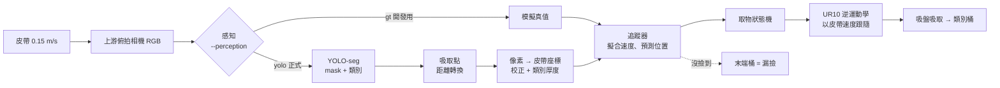

# trash-sorter：Isaac Sim 輸送帶垃圾分類

大學專題。在 NVIDIA Isaac Sim 裡模擬一條輸送帶：上游相機拍照 → YOLO 實例分割辨識 →
UR10 手臂用吸盤**在皮帶不停的情況下**把物體吸起來 → 丟進對應的桶子。

- **只做模擬**，沒有實體機器人。
- sim-to-real 的證明方式：
  - **(B)** 只用合成影像訓練的 YOLO，在**真實手機照片**上量 mask mAP50；並和「模擬 + 少量真實照片微調」比較。
  - **(C)** 即時 webcam demo。
- 類別：`pet_bottle`（寶特瓶）、`aluminum_can`（鋁罐）、`paper_carton`（紙盒 / 利樂包）、`glass_bottle`（玻璃瓶）。

完整設計：[docs/design.md](docs/design.md)。
上一版原型（氣壓缸推桿 demo）：[nuume-trash-classification/pneumatic-demo](https://github.com/nuume-trash-classification/pneumatic-demo)。



## 目前狀態（v1）

不需要人工的部分都已完成，可以直接跑。需要人做的部分先用**替代品**：

| 東西 | 現在用的 | 之後換成 |
|---|---|---|
| 3D 模型 | 程式產生的圓柱 / 方塊（每類 6 種） | 網路模型 + 手機掃描（工作流 1） |
| 訓練資料 | 用替代模型產生的合成影像 | 用真實模型重新產生（工作流 2） |
| 真實照片 / 標註 | 沒有 | 300 張測試 + 50–100 張微調（工作流 3） |
| YOLO 權重 | 不進 git；照「快速開始」第 3–4 步自己產生（約 15 分鐘） | 用真實模型的資料正式訓練（工作流 2） |

v1 驗證結果請看本頁最下面「[驗證紀錄](#v1-驗證紀錄)」。

## 資料夾

```
trash-sorter/
  trash_sorter/        純 Python 核心（不需要 Isaac Sim，有單元測試）
    config.py            所有尺寸、類別、相機、桶子位置（唯一的設定來源）
    geometry.py          像素 <-> 皮帶座標、從 mask 找吸取點、運動預測
    perception.py        感知介面 + YOLO 感知（final 模式）
    tracking.py          多物體追蹤（擬合每個物體的實際速度）
    picking.py           動態取物狀態機（追、吸、抬、送、放）
    ur10.py              UR10 解析解正 / 逆運動學
    metrics.py           取物成功率、漏撿率、分類正確率
    yolo_format.py       YOLO-seg 標籤讀寫、疊圖
  sim/                 在 Isaac Sim 的 Python 裡跑
    scene.py             場景：輸送帶 + 相機 + UR10 吸盤 + 5 個桶
    run_sorter.py        完整分類流程，--perception gt|yolo，印出指標
    datagen.py           Replicator 合成資料 -> YOLO-seg 資料集
    gt_perception.py     開發用：直接讀模擬真值（不能當成果）
    assets/              工作流 1：替代資產產生器、批次轉檔、資產清單
  perception/          訓練 / 評估 / 真實照片匯入 / 標籤檢查 / webcam demo（uv 環境）
  scripts/isaac.cmd    用 Isaac Sim 的 Python 執行腳本（Windows）；isaac.sh 給 Git Bash
  tests/               pytest
  docs/design.md       設計
```

不會進 git 的：`data/`（資料集）、`runs/`（訓練結果、權重）、`outputs/`（模擬結果、截圖）、
`sim/assets/usd/`（產生的 USD）、`sim/assets/raw/` 裡的模型。

## 安裝

需要：Windows 11、NVIDIA GPU、[uv](https://docs.astral.sh/uv/)、Isaac Sim 6.1（pip 版，裝在自己的 venv）。

1. **Isaac Sim 的 venv**：預設位置是 repo 旁邊的 `../env_isaacsim`
   （也就是 `repo/env_isaacsim` 和 `repo/trash-sorter` 在同一層）。
   放在別的地方的話，設定環境變數：

   ```bat
   set ISAACSIM_PYTHON=D:\path\to\env_isaacsim\Scripts\python.exe
   ```

   `--perception yolo` 需要在 Isaac Sim 的 venv 裡加裝 ultralytics（不要動到它的 torch / opencv）：

   ```bat
   %ISAACSIM_PYTHON% -m pip install --no-deps ultralytics ultralytics-thop polars polars-runtime-32
   ```

   Isaac Sim venv 裡的 torchvision 是 CPU 版，所以模擬中的 YOLO 會自動改用 CPU 推論（nano 模型夠快）。

2. **訓練 / 評估 / demo 的 uv 環境**（會裝 CUDA 版 torch，約 3 GB）：

   ```bat
   uv sync
   ```

   只跑單元測試、不想裝 torch 的話：`uv sync --no-group ml`。

第一次跑模擬會從 NVIDIA 雲端下載 UR10 模型，需要網路。

## 快速開始

以下指令都在 repo 根目錄執行（Windows cmd / PowerShell）。

```bat
:: 1. 單元測試
uv run pytest

:: 2. 開發模式跑分類（讀模擬真值，不需要模型），開視窗看
scripts\isaac.cmd sim\run_sorter.py --perception gt --duration 120

::    無畫面，跑完印指標；每 2 秒存一張總覽圖到 outputs\run_*\overview
scripts\isaac.cmd sim\run_sorter.py --perception gt --headless --duration 300 --snapshots 2

:: 3. 產生合成資料（1500 張約 5 分鐘）
scripts\isaac.cmd sim\datagen.py --frames 1500 --name sim_v1

:: 4. 訓練 YOLO-seg（只用模擬資料）
uv run python perception/train.py --data data/synthetic/sim_v1 --name sim_only --epochs 60

:: 5. 正式模式：只用相機影像
scripts\isaac.cmd sim\run_sorter.py --perception yolo --weights runs\segment\sim_only\weights\best.pt --headless --duration 300

:: 6. Webcam demo
uv run python perception/live_demo.py --weights runs\segment\sim_only\weights\best.pt
```

`run_sorter.py` 的結果在 `outputs/run_<時間>/`：`metrics.json`、`summary.txt`、`events.json`
（加 `--save-camera` 會把每張相機影像和偵測結果存下來）。

### 兩種感知模式（唯一的切換點）

| 模式 | 用什麼 | 用途 |
|---|---|---|
| `--perception yolo`（預設） | 只用相機影像 + 皮帶速度 | **正式成果** |
| `--perception gt` | 直接讀模擬器裡物體的位置與類別 | 只給手臂開發用，不能當成果 |

兩者輸出一樣的 `Detection`，後面的追蹤、取物完全一樣。切換點在 `sim/run_sorter.py` 的
「Perception」段落，介面定義在 `trash_sorter/perception.py`。

## 四個工作流（每人一個）

### 工作流 1：3D 資產（`sim/assets/`）

目標：每類 10–20 個真實模型。**不手動改模型**，全部用腳本處理。

1. 從 Objaverse / Sketchfab 下載，或用手機掃描（Polycam、Scaniverse 等匯出 .obj / .glb）。
2. 放到 `sim/assets/raw/<類別>/`，在 `sizes.csv` 寫實物最長邊（詳見 [sim/assets/raw/README.md](sim/assets/raw/README.md)）。
3. 批次轉檔：`scripts\isaac.cmd sim\assets\convert_assets.py`，看 `sim/assets/usd/real/report.csv`。
4. 跑 `run_sorter.py --perception gt` 看物體在皮帶上是否正常、吸盤吸不吸得起來。

注意：模型要能「平躺」在皮帶上（腳本會把最長邊轉到皮帶方向、最薄邊朝上）。
感知用「各類別已知厚度」算吸取高度（`config.CLASS_SPECS[...].thickness`），
如果真實物體厚度差很多，請一起更新 `config.py`。

### 工作流 2：合成資料 + 訓練（`sim/datagen.py`、`perception/train.py`）

1. 工作流 1 有真實模型後，重新產生資料：`scripts\isaac.cmd sim\datagen.py --frames 5000 --name sim_v2`。
2. 打開 `data/synthetic/<name>/preview/` 檢查標籤疊圖。
3. 訓練：`uv run python perception/train.py --data data/synthetic/sim_v2 --name sim_only --epochs 80`
   （可試 `--model yolo26s-seg.pt`）。
4. 調整 domain randomization（`datagen.py` 的 `randomize()`）：看真實照片長什麼樣，往那個方向加變化。

### 工作流 3：真實照片與標註（`perception/prepare_real.py`、`perception/show_labels.py`）

1. 拍照：手機從上往下拍，背景要像輸送帶（深色、平面），每張 1–4 個物體，各類別數量差不多。
   - **測試集約 300 張**，**微調集 50–100 張**，兩組要是**不同照片**（最好不同天 / 不同物體）。
2. 在 CVAT 或 Roboflow 標註**多邊形**，類別名稱一定要用：
   `pet_bottle`、`aluminum_can`、`paper_carton`、`glass_bottle`。匯出格式選 **YOLO segmentation**。
3. 匯入（會自動對應類別、檢查兩組照片沒有重複）：

   ```bat
   uv run python perception/prepare_real.py --source exports\cvat_test --dest test
   uv run python perception/prepare_real.py --source exports\cvat_finetune --dest finetune
   uv run python perception/show_labels.py data/real/test
   ```

4. **測試集在最後評估前不要拿來訓練或調參數**（`train.py` 會拒絕用它訓練）。

### 工作流 4：評估、手臂與 demo（`perception/eval.py`、`sim/run_sorter.py`、`perception/live_demo.py`）

1. 微調：

   ```bat
   uv run python perception/train.py --data data/real/finetune --name sim_plus_real ^
       --model runs\segment\sim_only\weights\best.pt --epochs 40 --lr0 0.002
   ```

2. 最終評估（只做一次）：

   ```bat
   uv run python perception/eval.py --data data/real/test ^
       --weights runs\segment\sim_only\weights\best.pt runs\segment\sim_plus_real\weights\best.pt ^
       --names sim_only sim_plus_real
   ```

   會印出整體與各類別 mask mAP50（玻璃另外列），並對照成功標準。
3. 模擬取物：`run_sorter.py --perception yolo`，目標取物成功率 ≥ 95%、記錄漏撿率。
4. Webcam demo：`live_demo.py`（按 `s` 截圖，`--save demo.mp4` 錄影）。

## 成功標準

| 項目 | 最低 | 目標 |
|---|---|---|
| 真實照片 mask mAP50（只用模擬） | ≥ 0.5 | ≥ 0.7 |
| 真實照片 mask mAP50（模擬 + 微調） | 比只用模擬高 | ≥ 0.85 |
| 玻璃瓶 | 分開報告 | |
| 模擬取物成功率（0.15 m/s） | ≥ 80% | ≥ 95% |
| 漏撿率 | 要記錄 | |

## v1 驗證紀錄

2026-10-22 在 RTX 4080 SUPER 上實際執行。**全部用替代資產**，數字只代表「流程可以跑通」，不代表真實表現。

| 驗證 | 結果 |
|---|---|
| 單元測試 `uv run pytest` | 76 passed |
| `ruff check` / `ruff format` | 通過 |
| `run_sorter.py --perception gt --headless --duration 300` | 70 個物體：**取物成功率 90.0%（63/70）**、漏撿率 10.0%、分類正確率 100%、掉落 0 |
| `datagen.py --frames 1500` | 約 5 分鐘；每類約 860–910 個實例；抽查疊圖，標籤貼合物體邊緣 |
| `train.py`（yolo26n-seg，40 epoch） | 合成驗證集 mask mAP50 = 0.993（同領域，**不是**真實照片成績） |
| `run_sorter.py --perception yolo --headless --duration 300` | 70 個物體：**取物成功率 85.7%（60/70）**、漏撿率 14.3%、分類正確率 96.7%、掉落 0（修正透視偏差後；修正前 74.6%） |
| `live_demo.py` | webcam 0 與影片檔都能跑；有遮罩、類別、吸取點 |

已知問題（v1）：

- YOLO 模式原本只有 74.6%，失敗全是瓶子。用 `--debug` 比對吸盤位置和真實位置後，
  找到原因是**像素轉座標的透視偏差**（細節見 `docs/design.md`「實作補充」），修正後 85.7%。
  剩下的失敗仍然以瓶子為主：偶爾吸不住、搬運中掉落、玻璃瓶偶爾撞到桶邊彈出（桶只有 30 cm 寬，玻璃瓶最長 26 cm）。
  同一個 seed 重跑結果也會差幾個百分點（模擬不是完全可重現），三次修正後的 300 秒執行分別是 84.3%、88.4%、85.7%。
- 寶特瓶和玻璃瓶的替代模型長得很像，偶爾分類搖擺，平均信心低於 0.5 的 track 不會被撿（進末端桶）。
- 在模擬中跑 300 秒約需 10–14 分鐘（headless，含 RTX 渲染）。
- `--perception gt` 會讀模擬真值，**只能用來開發手臂**，不能當成果。
